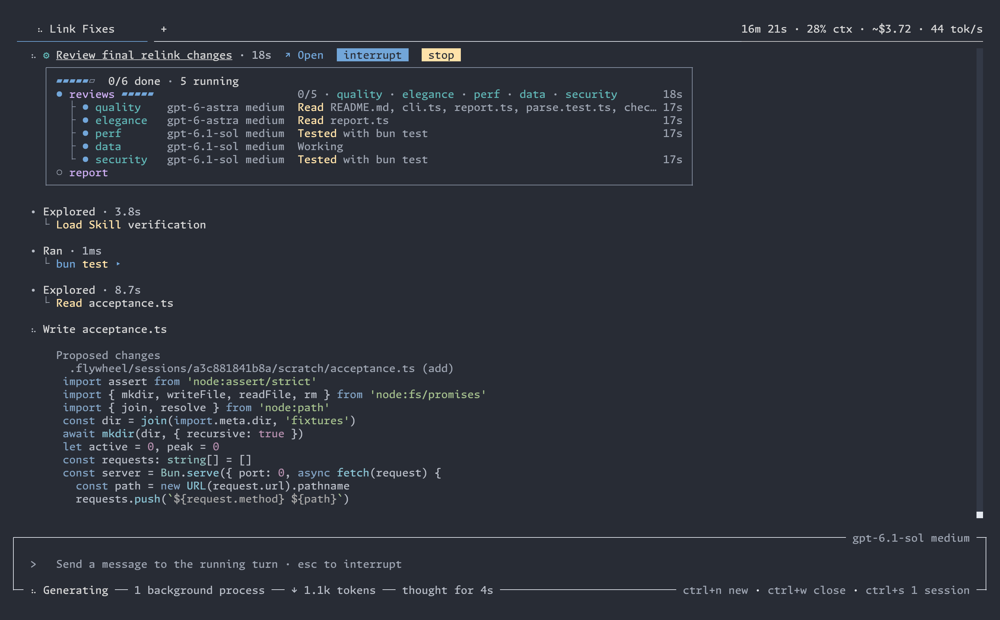
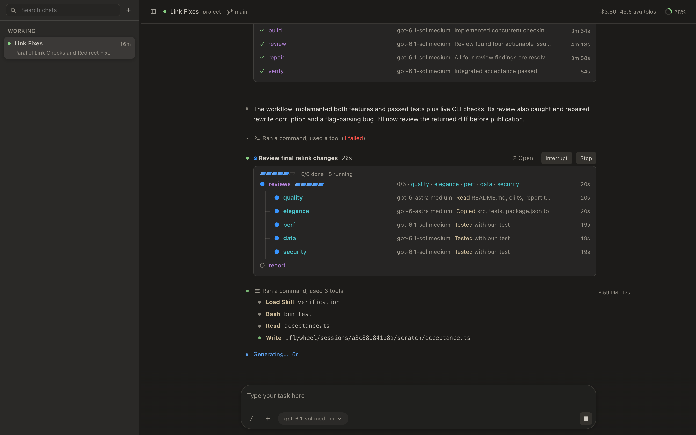
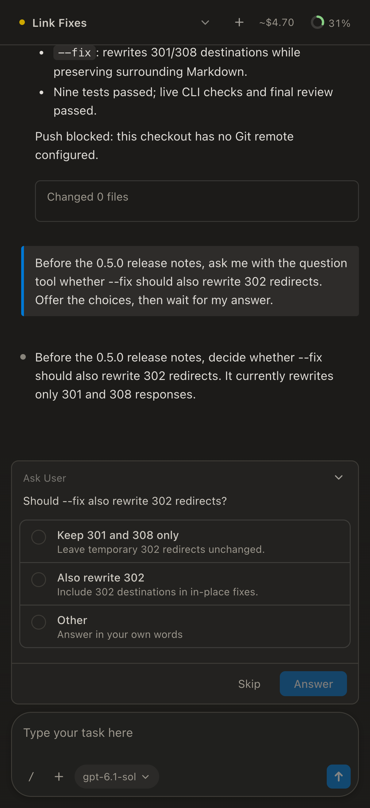
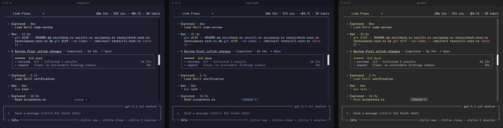

# Flywheel

<p align="center"><b>The coding agent that keeps working.</b></p>

<p align="center">
  <a href="LICENSE"></a>
  
  
</p>

Flywheel is an open-source coding agent for your terminal, your browser, your phone, and VS Code. If you already use a coding agent, this is what Flywheel adds.

## Why Flywheel

- **Every subscription you pay for, in one pool.** Sign in to Claude, ChatGPT, GitHub Copilot, SuperGrok, and OpenCode Go, with as many paid accounts of each as you have. When one account hits its cap, Flywheel moves to the next one without ending the turn.
- **Multi-agent workflows that cost less.** Ask for a big job and the agent runs a team of agents that build, review, repair, and verify, on any model. In a head-to-head benchmark on the same model, Flywheel's workflows used 30% less estimated cost, took 5% less time, and won twice as many blinded quality comparisons as they lost.
- **Runs that keep going.** Close the terminal, update Flywheel, or run out of quota, and the work continues. After a crash, it resumes where it stopped.
- **It does what you asked, and no more.** No scope creep, no features you did not ask for, no over-engineering.
- **The right model for every job.** Give each role its own model and effort, from any provider: a cheap, fast model to search the code and a strong one to review it.
- **One session on every screen.** Start in the terminal, follow along in the browser, and answer the agent from your phone. Every client shows the same live session.
- **Work and personal, kept apart.** Bind each project to a profile. A work repository never spends your personal subscriptions.
- **It learns as you work.** Flywheel remembers your preferences and turns what you teach it into skills that it uses next time.
- **Many sessions, one window.** Run as many sessions as you want in tabs in one terminal.

<p align="center"></p>

## Install

macOS and Linux:

```bash
curl -fsSL https://github.com/wsauret/flywheel/releases/latest/download/install.sh | bash
```

Windows (PowerShell):

```powershell
irm https://github.com/wsauret/flywheel/releases/latest/download/install.ps1 | iex
```

Then run `flywheel` in a project directory. On first launch, the provider picker opens so that you can sign in.

## Every subscription you pay for, in one pool

Sign in with **Claude, ChatGPT, GitHub Copilot, SuperGrok, or OpenCode Go**, and add several paid accounts of each. Add API keys for **Anthropic, OpenAI, Google, DeepSeek, OpenRouter**, or any OpenAI-compatible endpoint.

- When an account hits its usage cap or goes down, Flywheel switches to the next account automatically. You never retry by hand.
- For Claude, the account whose weekly window resets soonest goes first, so quota that is about to expire gets used first.
- Subscriptions serve first. API keys serve only when no subscription can.
- Paid overage starts off, and Flywheel asks once per account before it uses it. Claude can bill one response before Flywheel learns of it; Flywheel then stops using that account.
- The Usage view shows each account's reported allowance and reset time, and your usage over time. You choose when it alerts you.
- Switch a chat between Claude, GPT, and other models at any point. The conversation carries over.
- Claude signs in through Anthropic's official Claude Agent SDK. Flywheel never reads, stores, or sends your Claude token. [How each sign-in follows its provider's terms](docs/provider-terms.md).

## Multi-agent workflows that cost less

Describe the work in chat. For a big job, the agent writes a workflow and launches it: a team of agents that build, review, repair, and verify, with independent work running at the same time. It runs on any model from any provider you have.

We compared Flywheel with a leading coding agent's built-in workflow mode, on 11 tasks with 4 runs each. Both used Sonnet at medium effort for the main work. Flywheel's workflows had:

- **30% lower** estimated API-equivalent cost
- **5% less** time on average
- **22 wins, 11 losses, and 11 ties** in blinded quality judging

[The full results](bench/findings/workflow-audit-results.md) give the method, every table, and the caveats.

- A live card shows each phase and each agent. Open any agent to see its work.
- Set a budget of tokens, minutes, or agent attempts for a workflow.

## Runs that keep going

Your work does not depend on your terminal window.

- Close the terminal. The run continues.
- Update Flywheel mid-run. Running builds and tests keep going, and agents continue on the new build.
- Out of quota at 2 a.m.? The agent waits for the reset, then continues.
- After a crash, press Resume. Agents that were mid-task continue where they stopped, and finished work stays finished.
- In a long session, your goal and your decisions survive when the context fills up.
- When a provider refuses a request because of content in the conversation, Flywheel tries to remove that content and continue.
- If a new release cannot start on your machine, Flywheel goes back to the last release that worked.

## It does what you asked, and no more

Coding agents tend to do more than you asked. Flywheel does not.

- **It keeps to your request.** No features, refactors, or "improvements" that you did not ask for.
- **It does not over-engineer.** You get the simplest design that does the whole job, and no code for problems that cannot happen.
- **It builds what you approved.** Every agent on a job stays on the plan that you agreed to.
- **It proves the work.** An agent says a change is done only after it has seen the change work.

## The right model for every job

Give each role its own model and effort: the chat, workflow agents, the explorer, the implementer, each kind of reviewer, and background work. Mix providers freely, such as a cheap, fast model for searching and a strong model for review. `/model` changes them, and the model picker shows the price of each model and which of your providers serve it.

## One session on every screen

<p align="center">
  
  
</p>

Every client attaches to the same live session. Start a job in the terminal, follow it in the browser, and answer the agent's question from your phone.

- `flywheel web` opens the web client. Only your machine can reach it.
- `/remote` pairs your phone with a QR code. No account, no password.
- Every message is sealed end to end. The relay cannot read it.
- Your phone notifies you only when a chat needs your answer.
- From your phone, wake a project that is asleep, or clone a repository onto your machine.
- `flywheel --remote` drives your main machine from a terminal on another computer.
- The VS Code extension opens Flywheel's diff review in an editor tab, with undo for each file.

## Work and personal, kept apart

Keep separate sets of accounts and model choices, such as Work and Personal, and bind each project to one. A work repository never spends your personal subscriptions, and a side project never spends your employer's. Each chat keeps the profile it started with. `/profile` switches it.

## It learns as you work

While you work, Flywheel saves your preferences and turns what you teach it into skills that it uses in later sessions. Every skill is a file that you can read, and `flywheel skills why` shows which chats it came from.

## Many sessions, one window

Run as many sessions as you want in tabs in one terminal window. `ctrl+n` opens a new tab, and `ctrl+s` finds any earlier session.

## Your terminal, your colors

<p align="center"></p>

Flywheel ships about 40 themes, from Catppuccin to Gruvbox, and a new theme applies at once, with no restart. `flywheel font install` installs Monaspace, the font that Flywheel is designed around.

## Smaller things that matter

- **No account, no analytics.** Flywheel collects no usage data. [Privacy](#privacy) lists what it sends.
- **Search every chat.** `/find` searches the text of this chat or of every chat in the project.
- **Measured speed.** `/stats` compares the measured speed of each model and effort.
- **Edits as they are written.** File edits show as diffs while the model is still writing them.
- **Everything is on the record.** `flywheel events search` shows what each agent did, and when.
- **Turn anything off.** About 20 capabilities each have one switch.
- **Workflows in CI.** `flywheel --headless` runs a chat in scripts and CI, and that chat can launch workflows.
- **Side questions.** `/btw` asks a quick question about the chat without interrupting its work. The answer stays out of the transcript.
- **Background commands.** Builds, test suites, and dev servers run while the agent keeps working, and each result reaches the agent when it ends.
- **Training-route consent.** Model routes that may train on your data stay off unless you allow them for that profile. Other requests follow your provider's terms.

## Status and requirements

Flywheel is early software. The version is 0.x, and interfaces, commands, and settings can still change from one release to the next.

- **Platforms:** macOS, Linux, and Windows. [Platforms](#platforms) lists each build.
- **A model provider:** a subscription to Claude, ChatGPT, GitHub Copilot, SuperGrok, or OpenCode Go, or an API key for Anthropic, OpenAI, Google, DeepSeek, OpenRouter, or an OpenAI-compatible endpoint. Flywheel has no model service of its own.
- **No runtime:** the release archive holds everything that Flywheel needs, including the Claude engine. You do not install Bun, Node, or another runtime.

## What's new

The [Releases page](https://github.com/wsauret/flywheel/releases) lists the changes in each release. While the version is 0.x, any release can include a breaking change. The notes of that release mark each breaking change and tell you what to do.

## Safety

Flywheel agents work without asking you to approve each step. They run shell commands and edit files with your user account's permissions.

- Guards catch ordinary mistakes, but they are not a sandbox. They do not confine the programs that an agent runs.
- `/changes` shows the session's file edits, with undo for each file. A shell command can also change files outside that record.
- For an untrusted repository, or work where a mistake would be costly, run Flywheel inside a boundary: a container, a virtual machine, a low-privilege account, or a disposable checkout.

## Platforms

Flywheel ships compiled binaries for macOS (Apple silicon and Intel), Linux (x64 and ARM64, glibc and musl), and Windows (x64 and ARM64). The installer picks the archive for your machine and verifies it against the published `SHASUMS256.txt`. Flywheel then updates itself without interrupting a running session. On Alpine, run `apk add libstdc++ curl` before you install.

## Documentation

The [user documentation](docs/README.md) lists the reference pages for the command line, the slash commands, the keys, and the configuration.

## Privacy

Flywheel needs no account and collects no analytics or usage data. For model inference, Flywheel sends your prompts and code only to the model providers that you configure. Agent tools can send content to other destinations, such as an MCP server, a web search service, or a host that a shell command reaches. Project state stays in the project's `.flywheel/` directory, and account settings stay in `~/.flywheel/`. Release builds send an automatic crash report with the error, the version, the platform, and recent diagnostic records. A report holds no conversation or file content. Turn off the Bug reports setting to stop crash reports. [What Flywheel sends over the network](docs/privacy.md) lists every request that Flywheel makes on its own, what it holds, and the controls that exist for it.

## Getting help

Ask questions in the [Q&A discussions](https://github.com/wsauret/flywheel/discussions/categories/q-a). [SUPPORT.md](SUPPORT.md) says where bugs, feature requests, and security reports go.

## Contributing

Read [CONTRIBUTING.md](CONTRIBUTING.md). The design lives in two living documents: architecture intent under `docs/architecture-intent/` and product intent under `docs/product-intent/`. Start with [agency](docs/architecture-intent/agency.md) to see why the system looks the way it does.

Credits for the open-source work that Flywheel adapts are in [THIRD-PARTY-NOTICES.md](THIRD-PARTY-NOTICES.md). Flywheel is licensed under [Apache 2.0](LICENSE).
